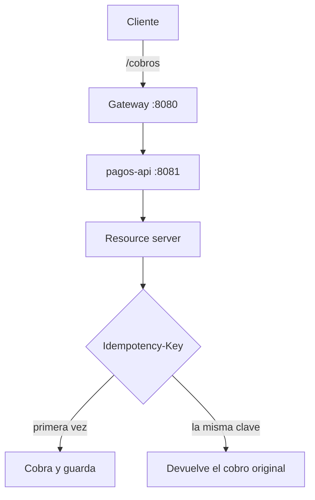

# Ruta de pagos

Una sola puerta para cobrar. El cliente habla con el gateway; el servicio de pagos cobra una vez por clave y no vuelve a cobrar si la misma clave regresa.

## Concepto

El comercio manda `Idempotency-Key`. La primera vez se acepta el cobro. La segunda, aunque traiga otro monto, devuelve el cobro original. El gateway WebMVC publica `/cobros/**` y deja pasar el header `Authorization`. El token de demostración lo firma el propio servicio con el cliente `ruta` / `oficio`.

## Stack

| Pieza | Para qué |
| --- | --- |
| Spring Boot 4.0.9 | Los dos módulos. |
| Spring Cloud 2025.1.4 | BOM y el gateway. |
| Spring Cloud Gateway | `spring-cloud-starter-gateway-server-webmvc`. Puerto `8080`. |
| API REST | `POST /cobros` y `POST /auth/token`. Puerto `8081`. |
| OpenAPI y Swagger | `openapi.yaml` y `/swagger` en pagos. |
| API-first | La prueba exige que el contrato nombre `Idempotency-Key`. |
| OAuth2 | Resource server con JWT HMAC de demostración. |
| Docker Compose | Gateway y pagos, con `PAGOS_URI`. |

## Flujo



## Correr

Desde esta carpeta:

```bash
mvn test
mvn -pl pagos-api spring-boot:run
mvn -pl gateway spring-boot:run
```

Después de `mvn -DskipTests package`, `docker compose up --build` levanta los dos.
